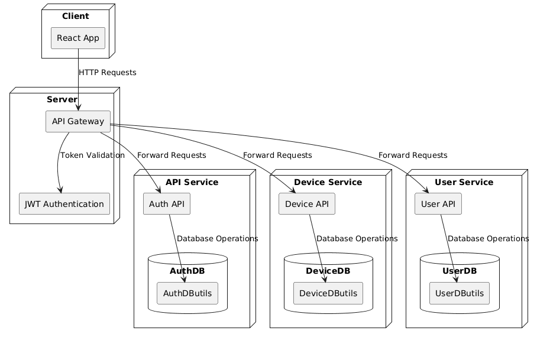

# Energy Management System (EMS)

An enterprise-grade Energy Management System designed to monitor, track, and manage smart energy devices and their consumption across multiple users. Built with a robust **Microservices Architecture** using **.NET 8**, **React**, and **Docker Swarm**.

## 🏗 Architecture & Technologies

The system is fully containerized and leverages an API Gateway with event-driven asynchronous communication. 

### Core Technologies
- **Backend:** .NET 8 (ASP.NET Core Web API)
- **Frontend:** React (Vite, JS)
- **Database:** Microsoft SQL Server
- **Message Broker:** RabbitMQ
- **API Gateway:** Traefik
- **Deployment & Orchestration:** Docker Swarm & Docker Compose

### Infrastructure & Load Balancing
The system utilizes a multi-layered approach to orchestration and traffic distribution:
1. **Container Orchestration (Docker Swarm):** Manages service lifecycles, high availability, and provides an internal overlay network (`ems-net`) for secure inter-service communication.
2. **API Gateway & L7 Routing (Traefik):** Dynamically discovers Swarm services and performs HTTP/WebSocket load balancing for all incoming external traffic.
3. **Event-Driven Load Balancing:** A custom `load-balancer-service` processes sensor payloads from RabbitMQ using **Consistent Hashing**, effectively distributing data streams across multiple `monitoring-service` replicas (scaled to 3 instances).

### Microservices
The system is divided into focused, highly decoupled services:
- `auth-service`: JWT generation and authentication.
- `user-service`: User identity and profile management.
- `device-service`: Management of smart energy meters and associations with users.
- `simulator-service`: Simulates smart meter readings and publishes them to RabbitMQ.
- `load-balancer-service`: Distributes data payloads via consistent hashing across monitoring queues.
- `monitoring-service`: Consumes sensor data, records history, and detects limit violations.
- `customer-support-service`: Manages support tickets and interactions.
- `websocket-service`: Handles real-time client notifications (e.g., when energy limits are exceeded).

---

## 🚀 Getting Started

### Prerequisites
- [Docker](https://docs.docker.com/get-docker/) installed.
- Docker Swarm initialized (`docker swarm init`).

### Run the System

To deploy the entire stack using Docker Swarm:

```bash
cd EMS-app
# Optional: create a .env file based on .env.example
cp .env.example .env

# Deploy the stack
docker stack deploy -c docker-compose.yml ems
```

*Note: The frontend, API gateway, and all backend services will start automatically and configure themselves via Traefik.*

### Accessing the System
- **Frontend App:** `http://localhost:5173`
- **Traefik Dashboard:** `http://localhost:8080`
- **RabbitMQ Management:** `http://rabbitmq.docker.localhost`
- Services are routed through Traefik using `*.docker.localhost` hostnames (e.g., `http://auth.docker.localhost`).

---

## 📊 Deployment Diagrams

Detailed deployment and architecture diagrams are available in the [docs/images](./docs/images) directory.


*(See `docs/images/` for more details on component interaction and Swarm configuration).*
